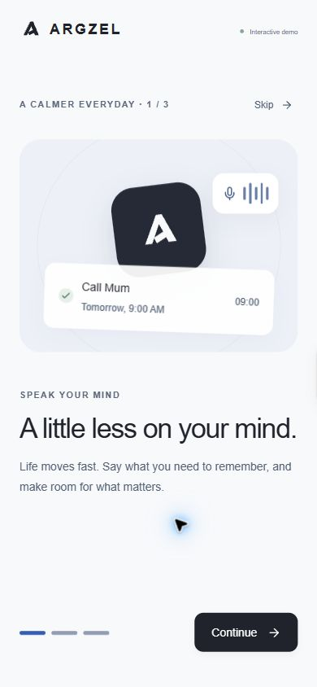
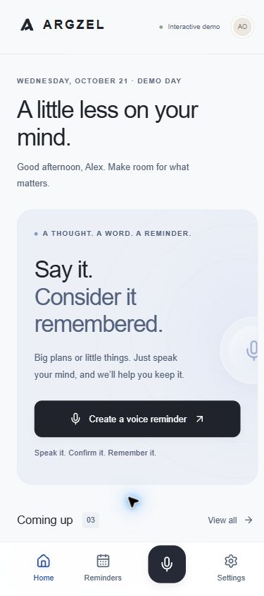
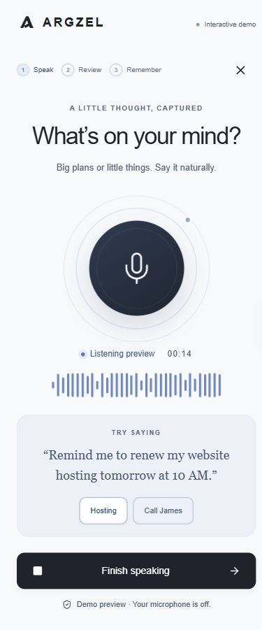
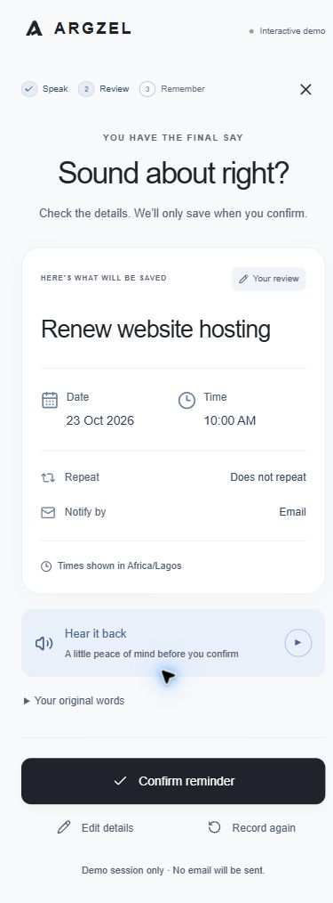

# ARGZEL

**Speak it. Confirm it. Remember it.**

ARGZEL is a mobile-first voice reminder app. Say what you need to remember in plain English. ARGZEL turns it into a structured reminder, shows you a preview and reads it back aloud. It saves only after you confirm, then emails you at the right time.

<p>
  
  
  
  
</p>

## How it works

1. **Speak:** "Remind me to renew my hosting next Friday at 10 AM."
2. **Transcribe:** Whisper turns the recording into text.
3. **Understand:** Gemma 4 extracts the task and describes *when*. Plain code then works out the exact date in your timezone, including DST.
4. **Clarify, don't guess:** if something is ambiguous, ARGZEL asks one short question with quick-pick answers.
   - "next Friday" asks which Friday;
   - "tomorrow morning" asks what time;
   - "at 7" asks AM or PM.
5. **Confirm:** you see and hear the reminder before anything is stored.
6. **Deliver:** a scheduler emails the reminder when it's due, with retries and no duplicate sends. Repeating reminders (daily, weekly, monthly) move on to their next occurrence.

## Tech stack

| Layer | Choice |
| --- | --- |
| App | Next.js 16 (App Router, Route Handlers), React 19, TypeScript, Tailwind CSS |
| Database | MongoDB Atlas via Mongoose |
| Speech-to-text | Whisper `whisper-large-v3-turbo`, via Groq's OpenAI-compatible API (swappable for self-hosted faster-whisper) |
| Language understanding | Gemma 4 (`gemma-4-26b-a4b-it`) on the Gemini API |
| Email | Resend |
| Auth | Email + password (scrypt) with a signed httpOnly session cookie |
| Validation / tests | Zod, Vitest |
| Hosting | Render (Blueprint in `render.yaml`) |
| Monitoring | Sentry: errors, Gemma agent traces (`gen_ai` spans), and a cron monitor for the scheduler |

## Project status

| Area | Status |
| --- | --- |
| Backend API: auth, profile, reminder CRUD with a confirmation guard | Done, verified on MongoDB Atlas |
| Voice pipeline: transcription, Gemma parsing, clarification | Done, verified live (Whisper 6/6, Gemma 15/15 sample phrases) |
| Scheduler and email delivery | Done, real email delivered via Resend |
| Mobile UI: all screens, onboarding, voice flow | Done, **currently runs in demo mode** |
| Connecting the UI to the live API (sign-in, microphone, reminder list) | In progress |
| Production readiness: Sentry, env checks, health check, rate limits | Done; production build verified end to end against Atlas |
| Public deployment on Render | Ready to deploy (Blueprint + guide); waiting on the owner's Render setup |

The app you see at `localhost:3000` is a self-contained demo: sample data, stubbed sign-in, simulated voice. It needs no credentials. The real API is fully usable today, and the frontend already includes a typed live adapter (`src/lib/voice-service.ts`) that switches over once wiring is finished.

## Getting started

Requires Node.js 20.9+.

```bash
npm install
npm run dev
```

Open http://localhost:3000 and choose **Explore the demo**.

### Running the backend

Copy the template and fill in what you need:

```bash
cp .env.example .env.local
```

| Variable | Needed for |
| --- | --- |
| `MONGODB_URI`, `MONGODB_DB` | Everything that stores data |
| `AUTH_SECRET` | Sign-in sessions (at least 32 characters) |
| `GEMINI_API_KEY`, `GEMMA_MODEL` | Reminder parsing (Gemma) |
| `STT_API_KEY` (+ optional `STT_API_URL`, `STT_MODEL`) | Speech-to-text (Whisper) |
| `RESEND_API_KEY`, `EMAIL_FROM`, `APP_URL` | Reminder emails |
| `CRON_SECRET` | The every-minute scheduler call |
| `NEXT_PUBLIC_SENTRY_DSN` (optional) | Error and performance monitoring |

Each variable is only needed by the feature that uses it, and the demo UI needs none. `.env.example` explains each one and where to get the keys. To deliver due reminders locally, run `npm run cron:dev` alongside `npm run dev`.

### Scripts

| Command | What it does |
| --- | --- |
| `npm run dev` | Development server |
| `npm run build` / `npm start` | Production build and server |
| `npm test` | Unit and integration tests (scheduler tests use a local MongoDB if one is running, and skip otherwise) |
| `npm run test:live` | Checks Gemma against the real API with 15 sample phrases (uses API quota) |
| `npm run cron:dev` | Calls the reminder dispatcher every minute, locally |
| `npm run check:env` | Validates `.env.production` (or a given file) without printing values |
| `BASE=<url> npm run smoke` | 17-check smoke test of a running deployment (sends no email) |
| `npm run lint` / `npm run typecheck` | ESLint and TypeScript |

## API at a glance

All endpoints are under `/api` and use JSON. A session cookie is set on sign-in.

| Endpoint | Purpose |
| --- | --- |
| `POST /api/auth/signup` · `signin` · `signout` | Accounts and sessions |
| `GET` / `PATCH /api/me` | Profile, timezone, onboarding state |
| `GET` / `POST /api/reminders` | List, and save a confirmed reminder (`confirmed: true` required) |
| `GET` / `PATCH` / `DELETE /api/reminders/:id` | View, edit, delete |
| `POST /api/voice/transcribe` | Audio → text |
| `POST /api/voice/parse` | Text → reminder preview with clarification (never saves) |
| `POST /api/cron/dispatch` | Sends due reminder emails. Called every minute with `Authorization: Bearer $CRON_SECRET` |

Typed request and response contracts: `src/types/api.ts`.

## Project structure

```
src/
  app/            pages, styles, and API route handlers (app/api)
  components/     mobile UI screens and shared components
  hooks/, lib/    voice-flow state and the mock/live API adapters
  server/         backend only: db, auth, validation, models,
                  voice/ (Whisper, Gemma, date resolution), scheduler/, email/
  types/api.ts    API contract shared by frontend and backend
docs/             technical documentation and screenshots
public/brand/     logo and app icon
scripts/          local helpers (cron:dev)
```

## Documentation

- [Backend: architecture, data model, API reference](docs/BACKEND.md)
- [Voice parsing: pipeline, clarification rules, assumptions, test cases](docs/VOICE_PARSING.md)
- [Scheduling and email: status flow, duplicate prevention, setup, test checklist](docs/SCHEDULING.md)
- [Deployment and operations: Render, cron, Sentry, verification](docs/DEPLOYMENT.md)
- [Voice experience: UI flow and frontend integration](docs/VOICE_UX.md)
- [Design system: brand, palette, typography, components](docs/DESIGN_SYSTEM.md)

The brand identity board is at `/brand` when the app is running.

## Privacy and security

- **Audio is never stored.** It is forwarded from memory to the speech-to-text provider and discarded.
- **Nothing is saved without explicit confirmation**, and this is enforced by the API, not just the UI.
- **Passwords are hashed with scrypt.** Sessions are httpOnly, SameSite cookies.
- **Secrets live only in environment variables.** `.env*` files are git-ignored, except the template.
- **Logs record delivery outcomes only.** Notification logs never contain email content, and addresses in provider errors are redacted.
- **Monitoring collects no personal data.** Sentry gets no request bodies, cookies or AI prompts; users appear as account ids only.
- **Abuse limits.** Sign-in, sign-up and the voice endpoints are rate-limited.
