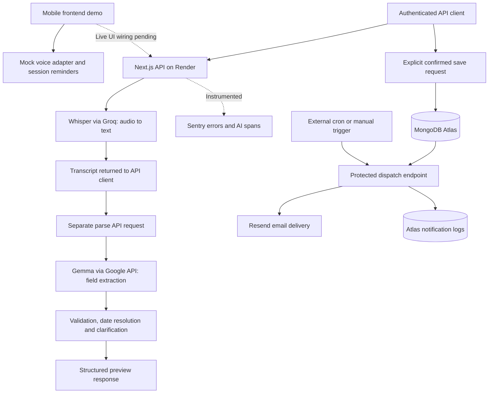

# ARGZEL — Submission assets

**Later implementation update:** [The frontend audit](FRONTEND_AUDIT.md) connected local account and capture paths after this draft was written. They passed fixture UI checks, not real provider/device acceptance. Revise public copy against that evidence before publishing; the historical checks below remain scoped as recorded.

Draft prepared 22 October 2026. Nothing has been published or entered into a prize category by this draft.

**Evidence boundary:** ARGZEL has a mobile frontend demo and a separately implemented backend. The frontend currently uses sample transcripts, stubbed authentication and session-only reminders. The backend implements real authentication, Whisper transcription, Gemma parsing, Atlas persistence and Resend delivery. Do not present the browser demo as a connected microphone-to-email workflow.

## 1. Concise product summary

**ARGZEL — Speak it. Confirm it. Remember it.**

ARGZEL is a mobile-first voice-reminder prototype that makes everyday plans easier to capture and review. Its backend turns natural-language instructions into structured reminders using Whisper and Gemma, asks for clarification when details are unclear, and stores reminders only after explicit confirmation. A polished browser demo shows the intended experience; connecting that interface to the live backend remains in progress.

**Short pitch:** A little less on your mind: natural-language reminders, clear previews, and your final say before saving.

## 2. Key problem statement

Remembering a small task can become another task: type a title, choose a date and time, set a repeat rule, and check that everything is correct. ARGZEL addresses that capture effort while preserving control over the result. Its central design decision is to ask about uncertainty and require confirmation before creating a reminder.

This is a product rationale, not a claim established by user interviews or a published user study.

## 3. How it saves effort

At the backend API level, one instruction supplies several reminder fields together. For example, “Every Monday at 7 AM remind me to pray” can produce a task, weekly recurrence and the next scheduled occurrence. “Tomorrow morning remind me to call James” prompts for a specific time instead of silently choosing one.

The frontend demo makes those fields easy to review and edit, offers optional browser read-back, and only adds a session reminder after Confirm. The backend can then handle due-reminder delivery, retries and recurrence progression without a user manually recreating each occurrence.

This fits **Slow and Steady** by reducing routine capture and follow-up work. Actual time saved versus manual entry has **not been measured**. The master spec's under-20-second goal is a target, not an achieved result. [Challenge prompt](https://dev.to/challenges/hacktoberfest-week3-2026-10-19).

## 4. Architecture summary

Next.js App Router, React, TypeScript and Tailwind provide the interface and API routes. The server uses Zod validation, scrypt password hashing, signed httpOnly sessions and owner-scoped reminder operations. Mongoose connects users, reminders and notification logs to MongoDB Atlas.

The transcription endpoint forwards audio in memory to Whisper via Groq. An API client then submits the transcript to the separate parsing endpoint, which calls Gemma through Google's API. Gemma extracts the task and describes when it should happen. Deterministic code resolves calendar dates, timezones, DST and ambiguity. Parsing does not create a reminder; a confirmed request to the reminders API does.

A protected dispatch endpoint claims due reminders with leases, sends through Resend using per-occurrence idempotency keys, records outcomes and advances recurring schedules. An external cron trigger is required for unattended operation. Render hosts the web service; it does not run the model inference itself. Sentry instrumentation is present for errors and AI spans.



The diagram shows implemented backend paths and the current UI integration gap, not an already connected end-to-end browser flow.

## 5. Open-source / open-weight AI: what and why

**Whisper `whisper-large-v3-turbo`, served through Groq:** supplies speech recognition. Whisper is an open-source speech-recognition project; ARGZEL's configured provider serves the Turbo variant. It converts audio into text so users need not transcribe their own instructions. The application forwards audio rather than storing recordings on its server. [Whisper project](https://github.com/openai/whisper), [Groq model documentation](https://console.groq.com/docs/model/whisper-large-v3-turbo).

**Gemma 4 `gemma-4-26b-a4b-it`, called through Google's API:** supplies natural-language field extraction. Gemma is an open-weight model family, and ARGZEL uses it for task and time-language interpretation while keeping exact calendar calculations in code. Its role is central to the real backend, not a decorative chatbot feature. [Google's model overview](https://ai.google.dev/gemma/docs/core.md).

Open models give this approach a route to inspectable and replaceable inference. The transcription endpoint/model is configurable, and the parser separates model extraction from deterministic scheduling. Those are implemented boundaries; local inference, self-hosted faster-whisper, model fine-tuning, offline operation and a cost advantage have **not** been demonstrated in this project. Hosted requests currently send audio or text to the configured providers. Browser read-back uses `speechSynthesis`.

## 6. Evidence of usefulness

The evidence demonstrates technical feasibility and control over reminder creation. It does not establish adoption, broad model accuracy, productivity gains or reliability at scale.

| Evidence                                     | Result and scope                                                                                                                                                                                                                   | Source                                                                                                                  |
| -------------------------------------------- | ---------------------------------------------------------------------------------------------------------------------------------------------------------------------------------------------------------------------------------- | ----------------------------------------------------------------------------------------------------------------------- |
| Fresh offline checks during this preparation | **48 tests passed across four files**, covering extraction/date resolution, voice adapter contracts and validation, and email-template behavior. No live model, database or email calls were run by this selected test command.    | Command below; `src/server/voice/*.test.ts`, `src/lib/voice-service.test.ts`, `src/server/email/reminder-email.test.ts` |
| Recorded live speech check, 22 Oct           | **6/6 synthesized sample phrases** transcribed correctly. Warm calls were about 0.5–0.9 seconds; the first cold call took 9.7 seconds. This is synthetic speech, not a microphone/noisy-environment benchmark.                     | [VOICE_PARSING.md](VOICE_PARSING.md), “Not covered / next”                                                              |
| Recorded live Gemma check, 22 Oct            | **15/15 selected phrase cases passed**; median 3.0 seconds, maximum 4.7 seconds per phrase. Uses a fixed test clock and selected expectations, not a general accuracy estimate or full-flow timing.                                | [VOICE_PARSING.md](VOICE_PARSING.md), `src/server/voice/gemma.live.ts`                                                  |
| Recorded deployed API smoke check, 22 Oct    | **17/17 checks reported**, including auth, confirmation guard, live parse and reminder CRUD. This exercises API calls, not the browser's mock flow.                                                                                | [DEPLOYMENT.md](DEPLOYMENT.md), `scripts/smoke.mjs`                                                                     |
| Recorded delivery check, 22 Oct              | A real reminder email was reported sent by the production dispatcher and delivered through Resend. The local delivery check separately recorded dispatch seven seconds after the due time. Neither observation is a delivery SLA.  | [SCHEDULING.md](SCHEDULING.md), [DEPLOYMENT.md](DEPLOYMENT.md), tracker Phases 7–8                                      |
| Frontend interaction checks                  | Previously recorded confirmation-only creation, cancellation without saving, missing-time correction, and existing-reminder editing without duplication; these use the mock adapter. Earlier responsive checks covered 320–1440px. | [VOICE_UX.md](VOICE_UX.md), [DEMO_CAPTURE.md](DEMO_CAPTURE.md)                                                          |

Fresh command run for this packet:

```sh
npm test -- src/lib/voice-service.test.ts src/server/voice/parse.test.ts src/server/voice/resolve.test.ts src/server/email/reminder-email.test.ts
```

The live provider, production-smoke and delivery figures above are **recorded results in project documentation**, not reruns during this preparation. Raw provider receipts and complete run outputs are not attached to this packet. A fresh read-only request to the public health endpoint timed out after 20 seconds during preparation, so current public availability is not reconfirmed. Preserve this distinction when presenting the results.

## 7. Prize category justifications

The current [HF26 category descriptions](https://dev.to/challenges/hf26) support these three implementation-backed entries, subject to the organizer's eligibility review:

| Category                      | Copy-ready justification                                                                                                                                                                                                                                                        | Evidence to attach                                                                                                                        |
| ----------------------------- | ------------------------------------------------------------------------------------------------------------------------------------------------------------------------------------------------------------------------------------------------------------------------------- | ----------------------------------------------------------------------------------------------------------------------------------------- |
| **Best Use of Render**        | “Render hosts ARGZEL's Next.js interface and reminder API. The service exposes the authentication, parsing, persistence and dispatch endpoints used by the implemented backend.”                                                                                                | `render.yaml`, working public URL, redacted deployment view and recorded API smoke result. Model inference is hosted by the AI providers. |
| **Best Use of Gemma**         | “Gemma is the reminder backend's language-understanding component. It extracts the task and temporal intent; deterministic code then resolves dates and asks for missing details. Our recorded live suite passed 15 selected phrase cases, including ambiguity and recurrence.” | `src/server/voice/gemma.ts`, `parse.ts`, `resolve.ts`, live-test suite and a captured genuine parse response.                             |
| **Best Use of MongoDB Atlas** | “Atlas is ARGZEL's persistent data layer for accounts, confirmed reminders and notification logs. It supports owner-scoped reminder retrieval and the scheduler's atomic claims and delivery state.”                                                                            | Models in `src/server/models/`, reminder routes, redacted Atlas collection/index view and recorded persistence/delivery evidence.         |

**Hold Best Use of Sentry Agent Tracing:** code includes `gen_ai.invoke_agent` and `gen_ai.chat` spans with model/token/attempt metadata, plus speech and delivery spans. However, this packet has no visible trace, token/cost evidence or trace-based debugging walkthrough. The official category specifically asks for traces or screenshots and what was learned from them; an SDK installation alone does not support the claim. Add this category only after those artifacts are captured.

Do not claim ElevenLabs, a .tech domain, Auth0, Temporal or other technologies for which this audit found no implementation. Browser speech synthesis, custom auth and the lease-based scheduler are the actual choices.

## 8. Demo script outline — approximately 2½ minutes

| Time      | Show                                                                   | Narration / point                                                                                                                                                                                                                                                  |
| --------- | ---------------------------------------------------------------------- | ------------------------------------------------------------------------------------------------------------------------------------------------------------------------------------------------------------------------------------------------------------------ |
| 0:00–0:15 | Dashboard and microphone action                                        | “Small reminders should not become another chore. ARGZEL makes the plan clear before you save it.”                                                                                                                                                                 |
| 0:15–0:25 | Demo label                                                             | “This interface currently runs in demo mode. I’ll show the review experience, then the separately implemented backend.”                                                                                                                                            |
| 0:25–0:50 | Hosting sample → processing → preview                                  | “The review puts the task, date, time, repeat rule and timezone together. Nothing is saved at this step.” Do not narrate the sample as live speech recognition.                                                                                                    |
| 0:50–1:10 | Edit, review, Confirm, success                                         | Change a detail, review it, then confirm. “Only confirmation adds it to this demo session.” Open details to show the result.                                                                                                                                       |
| 1:10–1:30 | Call James sample and missing-time question                            | “Tomorrow morning is not a precise time. ARGZEL asks instead of guessing.” Supply a time and show the corrected preview.                                                                                                                                           |
| 1:30–2:00 | Genuine backend evidence: parse response and confirmed stored reminder | Show a captured API-client run of Whisper/Gemma, the confirmation guard and Atlas persistence. Label synthesized input if used. Use recorded evidence if live services are unavailable, and say it is a recording. Never substitute mock output as provider proof. |
| 2:00–2:15 | Redacted delivered email / provider receipt                            | “The backend delivery path has sent a real reminder through Resend.” Show only a receipt actually captured; otherwise cite the documented check without displaying a fabricated inbox.                                                                             |
| 2:15–2:30 | Architecture and closing                                               | “Open models handle language; code handles calendar rules; you retain the final say. The next integration step is connecting the browser's auth, microphone and reminders to the live API.”                                                                        |

If backend evidence cannot be captured, shorten that segment and explicitly describe its verification as recorded in the project notes. Do not film an apparent live UI-to-email journey by splicing the mock and API paths together without disclosure.

## Editor's handoff — keep separate from public copy

- Repository configured in Git: [9jaDevo/ARGZEL](https://github.com/9jaDevo/ARGZEL). Confirm judge access and visibility before publishing. No root license file was found; do not describe the application itself as permissively licensed until its owner chooses a license.
- Recorded deployment: [argzel.onrender.com](https://argzel.onrender.com/), documented from commit `51dcbf0`. Audited local HEAD: `7f9a597`, with additional uncommitted frontend polish. The screenshot set and current local artwork must not be assumed to match the deployed commit.
- Visual assets and capture order: [DEMO_CAPTURE.md](DEMO_CAPTURE.md). Final onboarding: `docs/screenshots/final/01-onboarding.jpg`. Existing dashboard/voice screenshots are baseline captures, not a complete recapture of the final polish.
- No demo video URL or raw Sentry trace capture is available in this packet. Add the real URLs/artifacts after capture; leave them out rather than inventing links.
- No user study, manual-entry comparison, adoption count, end-to-end time measurement, cost comparison or physical-phone microphone acceptance was found. Avoid “under 20 seconds,” “100% accurate,” “zero duplicates,” “fully offline” and “production-ready” claims.
- Before publication: refresh availability; attach redacted run/receipt evidence; finish the video and final screenshots; verify the current official submission template, team attribution and AI-assistance disclosure; review organizer eligibility requirements. This packet authorizes no publishing or account actions.
- Event reference: [Hacktoberfest Open-Source AI Challenge: Week 3](https://dev.to/challenges/hacktoberfest-week3-2026-10-19), event 81, October 19–25, 2026. The published text says October 25 at 11:59 PM PDT, while the API's end timestamp is October 25 at 06:59 UTC. Confirm the exact cutoff with the organizer rather than relying on the later interpretation. General participation guidance was checked through [DevRelay's knowledge guide](https://devrelay.com/knowledge/dev-challenges).
